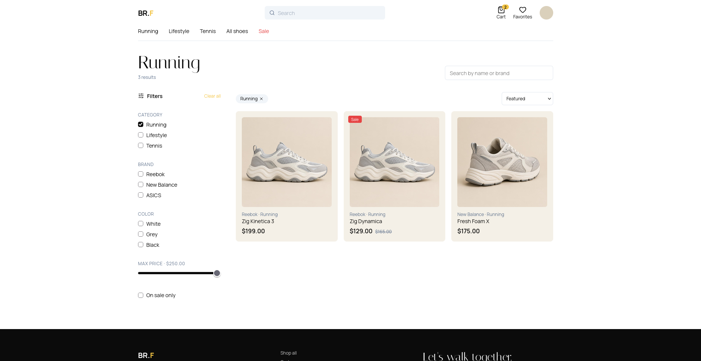
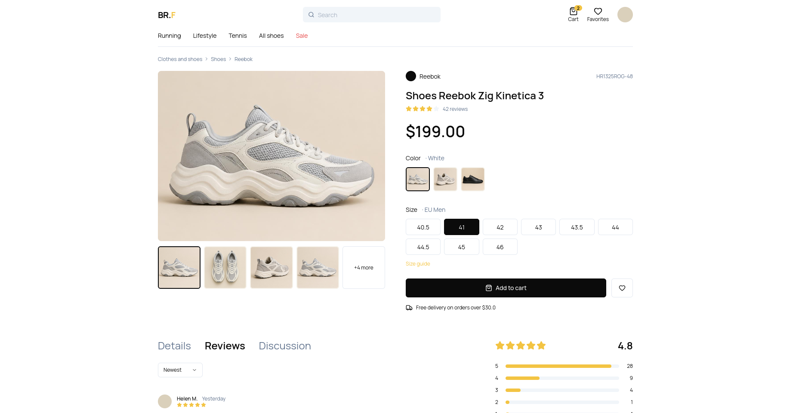
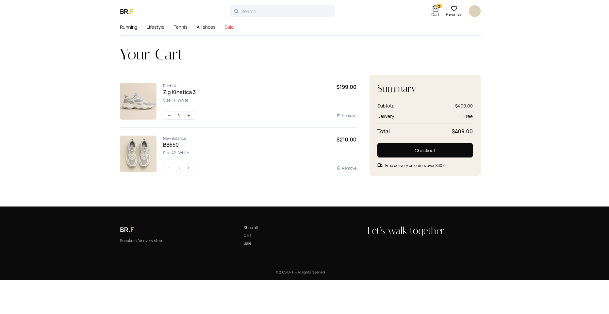

# Hellena Quick Start — Demo Store

Este repositório é um **Quick Start de demonstração** que mostra como integrar a plataforma **Hellena** numa aplicação de comércio eletrónico. O projeto serve como ponto de partida para explorar o SDK, perceber os principais fluxos de uma loja online e adaptar a implementação às necessidades do seu negócio.

- **Hellena:** [www.hellena.app](https://www.hellena.app)
- **Documentação:** [doc.hellena.app/docs](https://doc.hellena.app/docs)

> **Importante:** esta aplicação é uma demonstração. Os produtos e o carrinho incluem dados de exemplo, e o ecrã de pagamento indica que não é realizado qualquer pagamento real. Antes de usar em produção, configure credenciais, serviços, tratamento de erros, segurança e fluxos reais de encomenda e pagamento.

## Pré-visualização

As imagens abaixo estão disponíveis em [`.github/assets/`](.github/assets).

### Visão geral da loja


### Pesquisa de produtos



### Detalhes do produto



### Carrinho



## Funcionalidades demonstradas

- **Vitrine da loja:** página inicial com coleções, produtos em destaque e promoções.
- **Catálogo de exemplo:** produtos com marca, categoria, preço, imagens e indicação de desconto.
- **Pesquisa e filtros:** pesquisa por nome ou marca, filtragem por categoria, marca, cor e preço máximo, além de filtro de promoções.
- **Ordenação:** apresentação de produtos por preço crescente ou decrescente.
- **Página de produto:** galeria de imagens, seleção de cor e tamanho, informações do produto e avaliações/comentários demonstrativos.
- **Carrinho de compras:** adicionar produtos, ajustar quantidades, remover artigos e consultar o subtotal.
- **Checkout demonstrativo:** formulário de contacto, morada e opção de entrega.
- **Fluxo de pagamento de demonstração:** interface com opções ilustrativas de pagamento e confirmação sem cobrança real.
- **Integração com o SDK Hellena:** exemplos de chamadas para listar, pesquisar e obter produtos, criar encomendas, consultar métodos de pagamento, iniciar um pagamento WiPay e gerir comentários e avaliações.
- **Interface responsiva:** layout adaptado a diferentes tamanhos de ecrã.
- **Componentes reutilizáveis:** cabeçalho, rodapé, resumo do carrinho e componentes de interface.

### O que é exemplo e o que está integrado?

O repositório inclui módulos de ações que chamam o SDK Hellena. No entanto, algumas páginas e interações visuais usam dados locais e estados de demonstração. Consulte o código de cada fluxo antes de assumir que toda a experiência visual está ligada a dados reais.

## Tecnologias

- [Next.js](https://nextjs.org/) — App Router
- [React](https://react.dev/)
- [TypeScript](https://www.typescriptlang.org/)
- [Tailwind CSS](https://tailwindcss.com/)
- [@hellena-sdk/hellena](https://www.npmjs.com/package/@hellena-sdk/hellena) — SDK da Hellena
- [TanStack Query](https://tanstack.com/query) — dependência disponível no projeto

## Requisitos

- Node.js compatível com a versão do Next.js usada pelo projeto (recomendado: Node.js 22 LTS).
- npm.
- Uma chave de API Hellena para testar os módulos que comunicam com a plataforma.

## Começar

### 1. Clonar o repositório

```bash
git clone <URL_DO_REPOSITORIO>
cd quick-start
```

### 2. Instalar dependências

```bash
npm ci
```

### 3. Configurar as variáveis de ambiente

Crie um ficheiro `.env.local` na raiz:

```dotenv
HELLENA_API_KEY=a_sua_chave_de_api
```

Obtenha/configure as credenciais de acordo com a documentação da Hellena: [doc.hellena.app/docs](https://doc.hellena.app/docs).

**Nunca** publique a chave de API no repositório, no README ou no código do cliente. O ficheiro `.env*` está excluído pelo `.gitignore`.

### 4. Iniciar em desenvolvimento

```bash
npm run dev
```

Abra [http://localhost:3000](http://localhost:3000).

### 5. Verificar o projeto

```bash
npm run lint
npm run build
```

O comando de build necessita de `HELLENA_API_KEY` porque o cliente Hellena valida a presença dessa variável durante a inicialização.

## Integração Hellena no código

O cliente é inicializado em `src/lib/hellena.ts` através do pacote `@hellena-sdk/hellena`. As ações de servidor em `src/actions/` agrupam exemplos de operações:

| Ficheiro | Operações demonstradas |
| --- | --- |
| `products.ts` | Listar, pesquisar e obter produtos |
| `order.ts` | Criar uma encomenda |
| `payments.ts` | Consultar métodos de pagamento e criar um pagamento WiPay |
| `comments.ts` | Listar, obter, criar, atualizar e eliminar comentários |
| `ratings.ts` | Consultar resumos/avaliações e criar ou eliminar avaliações |

Consulte a [documentação oficial da Hellena](https://doc.hellena.app/docs) para conhecer os parâmetros, permissões e requisitos atuais de cada operação.

## CI/CD com GitHub Actions

O workflow [`.github/workflows/ci-cd.yml`](.github/workflows/ci-cd.yml) executa lint e build em pull requests e pushes para `main` e `develop`. A etapa de deploy para Vercel é opcional e só é executada quando os secrets necessários estão configurados.

Para ativar o deploy, adicione em **GitHub → Settings → Secrets and variables → Actions**:

- `VERCEL_TOKEN`
- `VERCEL_ORG_ID`
- `VERCEL_PROJECT_ID`
- `HELLENA_API_KEY` (a chave real usada durante o build de deploy)

Configure também o projeto Vercel para o mesmo repositório e confirme as definições de produção antes de ativar deploy automático. O workflow usa um valor fictício de `HELLENA_API_KEY` para a verificação CI; não é uma credencial funcional e não deve ser usado em produção.

## Estrutura principal

```text
src/
  actions/       # Exemplos de operações no SDK Hellena
  app/           # Páginas da loja e fluxos de compra
  assets/        # Imagens de exemplo
  components/    # Componentes de interface
  lib/           # Cliente Hellena e estado local da loja
  providers/     # Providers React
.github/
  assets/        # Capturas de ecrã para este README
  workflows/     # Automação CI/CD
```

## Contribuir

1. Crie uma branch para a sua alteração.
2. Faça as alterações e execute `npm run lint` e `npm run build`.
3. Abra um pull request. O workflow de CI valida automaticamente o código.

## Licença

Consulte o ficheiro de licença do repositório, se existir, antes de reutilizar ou distribuir este projeto.
